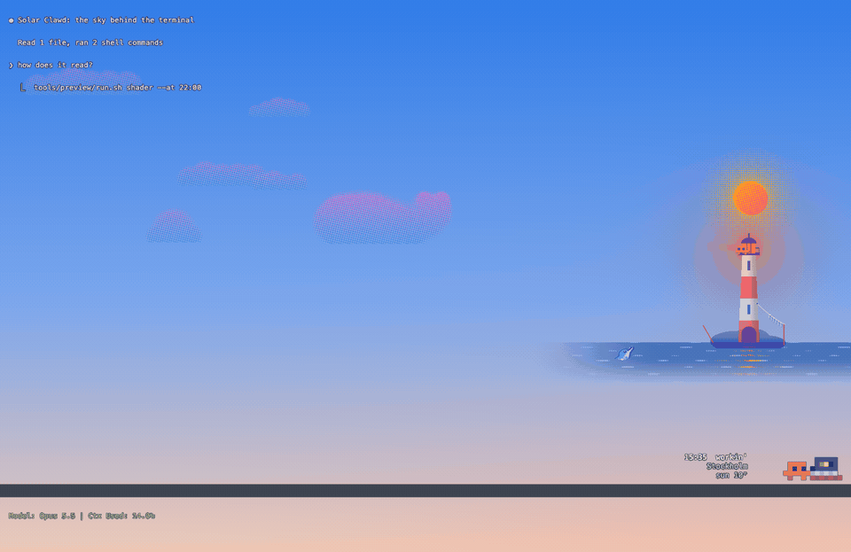
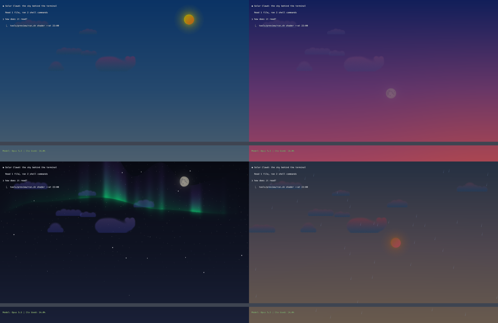

# Solar Clawd

A Claude Code mod that puts a living sky behind your terminal while Claude works. It follows the real sun, moon and weather where you are, and a pixel Clawd lives in a band above the prompt through his day — early birdin', coffee sesh, workin', vibin', night owl, sleep sesh — cheering when Claude finishes and facepalming when a tool fails.



Everything is printed in a risograph style: a handful of inks, halftone screens and a key plate slightly off register.

## What's in the sky



- **The real sky** — sun and moon positions and phases, bright stars and constellations, the ISS on its actual visible passes, aurora from NOAA's Kp index, and the weather from Open-Meteo (clouds, rain, snow, wind).
- **Small, rare events** — hot-air balloons, now and then a flying saucer among the clouds, migrating birds, planes with contrails, kites on windy days, autumn leaves, cherry blossom, a comet every couple of months, a dolphin leaping by the lighthouse (now and then a pink one), rainbows after rain, shooting stars (more during the Perseids and Geminids).
- **Swedish days** — Easter witches, the flag on National Day, a maypole at Midsummer, a Lucia procession, the Christmas star and Santa's sleigh, New Year's fireworks.
- **Claude's state** — a lighthouse far off on the horizon lights up and sweeps when Claude is waiting for you (orange for a question, white when done), and confetti falls after a long piece of work. In Ghostty the context window hangs by the lighthouse, a fish for each tenth on a line from the tower to the hammock's post: as another tenth fills the keeper lands one, and when the conversation is compacted or cleared he grills the catch on the rocks, and Clawd in the band looks round at the smell. Where there is no shader a wire wastebasket stands in the band behind Clawd instead: he tosses a ball of paper into it for each tenth, and when the conversation is compacted or cleared he throws in a match and the context burns away. He reads a book while Claude only reads, and types while it edits or runs commands.
- **The keeper** — in Ghostty the lighthouse is three times larger, and a small Clawd lives there: he fishes on the rocks, walks round the gallery, surfs a wave now and then, stargazes at night, and sleeps in a hammock from 03 to 06. When Claude waits for you he stands by the lit lantern, and every so often a UFO beams him up in a green light and kicks him out again a quarter of a minute later (`/solar event ufo abduction` and `/solar event surf` preview them).
- **Glass** — in Ghostty, Claude Code's own dark fields (a diff's red and green rows, your prompt's row, a shell command's row) let the sky through, tinted, as coloured glass would; text and everything else stay solid. Only on a dark background.

Events are a pure function of the time and the sky, so every session shows the same sky without keeping any state.

## What it costs

In Ghostty the sky is a shader run for every pixel of the window, every frame. Measured on an M1 Pro's built-in display, 3024×1964 at 120 Hz ([`docs/gpu-measurements.md`](docs/gpu-measurements.md)):

- **Out of focus it costs nothing.** Ghostty stops drawing a window out of focus while its terminal is still, so the GPU falls to where it is with no shader. The exception is the lighthouse's sweep, up to five minutes after Claude finishes or asks, when the sky keeps moving behind other windows.
- **In focus, any shader at all** keeps the GPU about 37 % busy at 0.8 W, an empty one as much as the sky: that is Ghostty drawing and compositing the window 120 times a second, and it halves at 60 Hz. The sky itself adds about 5 W by day and 6.5 W on a lit night.
- **Busy % says little.** The GPU lowers its clock until it is busy most of the time, so a heavy sky and a light one can both show 75 %; watts tell them apart. macOS 27 gives no GPU time per process, so these are the whole GPU's numbers.
- **On battery, and while you are away,** the sky leaves out its clouds, which takes about half of its cost by day.
- **At the sky's own pace it costs a sixth.** With `/solar full` or `/solar spar`, a small zsh beside Claude Code writes the tab 24 times a second (about 1 % of a core) and Ghostty draws the sky that often instead of 120. On Ghostty 1.4, with vsync on: focused by day 0.91 W against 5.6 W (−84 %), on a lit night −84 %, the floor −77 %. On 1.3, which needs vsync off (below), by day 1.26 W against 5.9 W (−79 %). In a blind trial 24 a second looked like 120. `full` keeps the sky moving behind other windows and on battery too, at about the same cost as focused (0.9 W by day on 1.4), and stands still after 20 minutes without you; `spar` moves only while Ghostty is in front and something in the sky moves, as without the pace, and costs nothing behind other windows.

## Requirements

- macOS, or Linux (see [Linux](#linux))
- [Claude Code](https://claude.com/claude-code) 2.1.275 or later
- [Ghostty](https://ghostty.org) 1.3 or later for the sky behind the terminal (iTerm2 gets it as a background image instead)

## Install

At the prompt of a Claude Code session:

```
/plugin install solar-clawd --marketplace Fiddy134/solar-clawd
```

Answer `y` to add the marketplace and pick a scope (user, so it runs in every session). From a shell, the same is `claude plugin install solar-clawd --marketplace Fiddy134/solar-clawd`.

Then, in a Claude Code session in Ghostty, run `/solar ghostty` once. It adds one optional include line to Ghostty's config; the included file names the shader while a Claude session runs and is empty otherwise. It also adds a right-hand margin of 240 points, where the lighthouse stands clear of the text; that is added once and kept when the sky is hidden. A config that already includes the mod gets the margin once, at the next session start in Ghostty, and a toast says so. From then on the margin is yours: change or remove its `window-padding-x` line and it stays as you leave it. The sky shows only in the tabs where Claude runs.

### Developing

Clone the repository, and let the session load a mirror of the clone rather than the clone itself:

```sh
git clone https://github.com/Fiddy134/solar-clawd ~/solar-clawd
~/solar-clawd/tools/dev/bootstrap.sh    # from a terminal window, not through Claude
```

The bootstrap keeps a copy of what the engine loads (the manifest, `hooks/`, `assets/`, `types/`) at `~/solar-clawd-live`, names it in `CLAUDE_CODE_PLUGIN_DIRS` in `~/.claude/settings.json`, and adds hooks to `.claude/settings.local.json` that run `.claude/hooks/mirror.sh` after each of Claude's edits and shell commands, so the session reloads the mod as you save; git hooks do the same after a switch, a merge, a rebase, a stash or a reset, and `tools/dev/watch.sh` (needs `fswatch`) after saves from an editor. The mirror follows the clone alone: work in a worktree reaches the sky once it is merged. The mirror is there for auto mode: Claude Code treats a loaded plugin folder as a protected path, so an edit inside one is never approved there and auto mode ends; editing the clone and loading the mirror keeps it on.

That protection exists so that code the engine runs is not changed with nobody reading it, and the mirror keeps to it: it copies only while you have armed it, by running `.claude/hooks/arm.sh` in a terminal window and typing four letters back (eight hours, or a number of hours, or `off`). Unarmed, nothing copies, and it says so once an hour when there is something to copy. Arming, the bootstrap and the mirror's `--now` refuse a shell with no terminal or one a session opened, which is what a session's own tool calls are, and Claude's `!` prompt too; and the scripts and their stamps live under `.claude/` and `.git/`, both protected, so nothing the session can rewrite unasked runs after its tool calls. Start a new Claude session after the bootstrap.

`claude plugin test .` runs the tests; `tools/preview/run.sh shader` and `tools/preview/run.sh band` render the sky and the band to PNGs without Ghostty (their flags are listed at the top of each file in `tools/preview/`), and `tools/preview/gif.sh` makes the GIF above.

#### The engine and its themes

The sky is an engine and a theme. The engine (`hooks/shader.ts` and `hooks/glsl/`) draws what every sky has: the sun, moon and stars, the clouds and the weather, the events that come and go, and it knows when Claude waits and how full the context window is. A theme draws a world under it. fyr, the one built in, is the lighthouse, its sea and its keeper ([`hooks/themes/fyr/README.md`](hooks/themes/fyr/README.md)).

To write a theme, read [`docs/THEME-GUIDE.md`](docs/THEME-GUIDE.md): it is all a theme's author needs, from the world a theme draws in and everything it can read to worked examples, a template and the checklist a theme is judged by, and a test holds it to the code. Themes written from it live in [`themes/`](themes/README.md).

A theme is a manifest and some GLSL. The manifest (`ThemeManifest` in `hooks/themes/theme.ts`) names the theme and the engine contract it is written for (`"engine": 1`), says what Claude waiting looks like in it, whether it shows the context window itself or leaves the engine's wastebasket in, and lists its own events: when they may come (the sun, the wind, the clouds, rain, the months), how often and for how long. Together they may keep the sky moving no more than 8 % of the time. The GLSL defines the four functions the engine declares and calls, and whatever they need:

```glsl
vec3 scenery(vec3 sky, vec2 p, float u, float k);   // the ground, the props, and the light that shows Claude waits
vec3 resident(vec3 sky, vec2 p, float u, float k);  // the characters and their things
vec3 themeEvent(vec3 sky, vec2 p, float u, float k, int kind, float seed, float t, bool isBehind);
float themeWindow(vec2 p, float u);                 // how much of the clouds, the events and the weather shows at p
```

A theme's text comes after the engine's in the shader, so it can call the engine's helpers (`COMMON` in `hooks/glsl/common.ts`: `pitch`, `night`, `keyInk`, `keyPlate`, `nightInk`, `smin`, `box`, `noise2`, `fbm`, `steam`, `lamp`, `sprite` and the rest) and read its constants (`THEME_SIGNALS` in `hooks/shader.ts`: the scene and the weather, `WAITING`, `CLAWD_ASLEEP`, `CLAWD_ACTIVITY`, `LOCAL_HOUR`, the day and the temperature). A function a theme leaves out, the engine stubs. The contract, the four functions with the helpers' signatures, the signals, the context window's `contextFish()`, `contextState()` and `CONTEXT_` states, and `shootingStarAge()`, is held by a test: changing it means a new contract number, and every engine name added after contract 1 starts with `sky_`, so it cannot collide with a theme's own. A theme built in is a TypeScript wrapper round exactly the two, so a theme from elsewhere, a `manifest.json` and a `theme.glsl`, can do all that fyr does.

The engine checks a theme's GLSL before it draws it. No `while` or `do`; `for` loops only as `for (int i = a; i < b; i++)`, with `a` and `b` whole numbers of at most 48 either way, `<`, `<=`, `>` or `>=`, a constant step toward the bound, an index the body leaves alone, and nested at most two deep; nothing that reads the terminal's image (`texture`, `iChannel`, `iPalette`: the context window comes through `contextFish()` and `contextState()`); no preprocessor, `discard`, `mainImage` or top-level `uniform`, `in` or `out`; and none of the engine's names defined again. And two caps: a theme's GLSL at most 80,000 characters, and the whole shader of a long night (04:00, the aurora, the ISS, the grill, every star up) at most 224,000, since every tab compiles the whole shader as it opens and on each reload.

- `tools/theme/run.sh lint <name|folder>` checks a theme and says what it weighs.
- `tools/theme/run.sh pack fyr <folder>` writes fyr as a `manifest.json` and a `theme.glsl`, and reads it back.
- `node tools/theme/guide.mjs template themes/<name>` writes the guide's template as a theme's folder. After a change to the guide, `node tools/theme/guide.mjs` copies it to `hooks/themes/guide.ts`, which its test reads, and `--check` says whether the copy is the guide as it is.
- `tools/preview/run.sh shader --theme <name|folder|none>` draws the sky with a theme, or with `none` the engine alone; with `--bench 200` it prints what the theme costs a frame (its frame less the engine's alone), and that against fyr's.
- `tools/preview/sheet.sh theme <name|folder>` draws a theme in the parity scenes, and each of its own events at three moments, as one contact sheet in `.preview/theme-<name>/contact.png`.
- `tools/preview/parity.sh record|check <dir>` compares the sky before and after a change to the engine, frame by frame, and `node tools/theme/imports.mjs` checks that no engine file imports a theme's folder or the band's character.

#### What a theme can read since 0.9.0

Every name the engine added after contract 1 starts with `sky_`, so a theme written for contract 1 still loads.

- **What Claude is doing.** `sky_tool()` is the kind of tool Claude's newest call still running is, in the main conversation or a subagent: `sky_TOOL_NONE`, `_COMMAND` (Bash), `_EDIT`, `_READ` (reads and searches), `_WEB` or `_OTHER` (anything else, MCP tools too); a kind shows at least 1.5 s. `sky_agents()` is how many subagents are at work, 0 to 7. Both travel in the tab's mark, palette colour 16, which the session writes to its own tab: they change at once, each tab its own, and cost no reload. Colour 16 is now at most rgb(31, 10, 6) where Claude runs, still all but black.
- **The market**, for a theme whose manifest says `"market": true`: `sky_QUOTE_PRICE[i]` and `sky_QUOTE_CHANGE[i]` (the day's change in percent) for `i` from `sky_BTC`, `sky_ETH`, `sky_NDX` (the Nasdaq-100), `sky_AAPL`, `sky_MSFT`, `sky_NVDA`, `sky_GOOGL`, `sky_AMZN`, `sky_META` and `sky_TSLA` (`sky_QUOTE_COUNT` of them); a price is 0 while unknown, and `sky_QUOTES_FRESH` is 1 while every price known was had in the last 15 minutes. Prices are five figures, stocks 15 minutes delayed, and a new price shows from the next scene on, so it changes the shader only when the scene does anyway (about every two minutes).
- **New York.** `sky_NEW_YORK_HOUR` (0 to 24, with its minutes), `sky_NEW_YORK_WEEKDAY` (0 to 6, 0 Sunday, New York's own day), `sky_TRADING_DAY` (1 all through a day the market trades on) and `sky_MARKET_OPEN` (1 from 09:30 to 16:00 there on a trading day, by NYSE's holidays and early closes) follow the scene's clock, as `LOCAL_HOUR` does.
- **Letters.** `sky_glyph(p, origin, cell, code)`, `sky_line16(p, origin, cell, int text[16])` and `sky_number(p, origin, cell, value, width, decimals)` draw a font of 3 by 5 cells: codes 0 to 9 for the digits, 10 to 35 for A to Z, then `sky_GLYPH_SPACE`, `_DOT`, `_COMMA`, `_COLON`, `_MINUS`, `_PLUS`, `_PERCENT`, `_SLASH`, `_DOLLAR`, `_BANG`, `_QUESTION`, `_QUOTE`, `_UP` (▲) and `_DOWN` (▼). A glyph advances 4 cells. `sky_glyphWide(p, origin, cell, code)` draws the same codes five cells wide, so that M, N and W read (the rest centred), advancing 6 cells. `--theme glyph-board` in the preview tools draws a board of them.
- **Behind the text.** `sky_under(color, sky)` is a colour no lighter than the sky behind it, its hue kept, for what a theme stands outside left of its stage, where the terminal's text runs.
- **A wider stage.** A manifest with `"stage": "wanted"` may ask `"stagePt"`: 240 (the default), 280, 320, 360, 400, 440 or 480 points. The first `/solar ghostty` writes the theme's width; on a config that already has the sky, `/solar ghostty` puts the mod's own `window-padding-x` line to the theme's width and leaves one you changed as you set it. The stage a theme draws on is never wider than the config's right padding. Ghostty gives each split its own padding, in whole points, and takes a changed one only in the tabs and splits opened after it, so a wider stage leaves a split fewer columns and shows in new tabs only. fyr keeps 240.

The price fetch runs only in a Ghostty session whose theme shows the market, so fyr fetches nothing. It asks, at most every five minutes and shared by every session through `runtime/market.json`: [Cboe](https://www.cboe.com)'s delayed quotes at `cdn-api.cboe.com`, one request for each of `_NDX`, `AAPL`, `MSFT`, `NVDA`, `GOOGL`, `AMZN`, `META` and `TSLA`; [Binance](https://www.binance.com)'s public market data at `data-api.binance.vision`, one request for BTC and ETH; and, only should Binance not answer, [Coinbase Exchange](https://exchange.coinbase.com) at `api.exchange.coinbase.com`, one request a coin. No key and no account: what reaches them is the request and your IP address. Cboe's terms allow its delayed data for personal, non-commercial viewing.

### The sky's pace

`/solar full` or `/solar spar` (the default) chooses the pace for every session. On Ghostty 1.3 the pace needs vsync off, which only you can turn on with `/solar vsync off`: Ghostty's own documentation warns that *out-of-sync rendering on macOS can cause kernel panics (macOS 14.4+)*. The mod writes `window-vsync = false` into a file of its own, `runtime/vsync.ghostty`, and includes that from the config beside the sky's include. It holds for **every Ghostty window, with Claude or without**, until `/solar vsync on`, whether or not the sky shows; it reaches tabs and windows opened after it (⌘T opens one), so restart Ghostty to have it everywhere. Until you say `/solar vsync off`, the sky runs as it always has. A later Ghostty that draws only when written to with vsync on needs no line, and the mod takes it away. On Linux the pace stays as it is for now.

Before you remove the mod, run `/solar vsync on`, or delete the `config-file = ?…/runtime/vsync.ghostty` line from Ghostty's config: nothing runs when a plugin is uninstalled, so the line would stay.

## Linux

Run by a few people so far; reports and fixes are welcome. `/solar ghostty` adds the include to `$XDG_CONFIG_HOME/ghostty/config.ghostty` (or to `config` if that is the file you have), defaulting to `~/.config/ghostty`.

The mod rewrites the shader and asks Ghostty to reload its config, which on Linux means a `SIGUSR2`:

- If Ghostty runs as its systemd user service, the mod runs `systemctl --user reload app-com.mitchellh.ghostty.service`, the way [Ghostty's docs](https://ghostty.org/docs/linux/systemd) recommend.
- Otherwise it sends `SIGUSR2` with `pkill -x ghostty`, but only if `ghostty --version` says 1.3 or later, since an older Ghostty would quit on that signal.

What differs from macOS:

- Ghostty draws with OpenGL there, so the shader flips its coordinates and reads the terminal's colours in linear light as well.
- Battery is read from `/sys/class/power_supply` (on battery the sky stands still and leaves out its clouds).
- There is no idle detection, so the sky keeps animating while you are away.
- No now-playing music in the band, and no iTerm2 background.

## Commands

| Command | |
|---|---|
| `/solar` | Hide or show the sky |
| `/solar demo` | A whole day in 48 seconds |
| `/solar HH:MM` | Pin a time today |
| `/solar YYYY-MM-DD HH:MM` | Pin a day, e.g. `/solar 2026-12-24 15:01` |
| `/solar now` | Follow the real sun again |
| `/solar place <city>` | Set the place (otherwise guessed from your IP, starting in Stockholm); `auto` goes back to guessing |
| `/solar events` | List the events |
| `/solar event <name>` | Play an event for 90 seconds |
| `/solar aurora` | Toggle a forced aurora |
| `/solar storm` | Toggle a storm |
| `/solar catch` | The keeper lands a fish, as when another tenth of the context window fills (without the shader, Clawd throws a ball of paper in the wastebasket) |
| `/solar grill` | The keeper grills his catch for a while, as on `/compact` or `/clear`, or without the shader the wastebasket burns (the conversation is not touched) |
| `/solar ghostty` | Add the sky to Ghostty's config |
| `/solar theme <name>` | Draw the sky with another theme in every session: fyr, built in, or a folder of [`themes/`](themes/README.md) (floor, terminal). The stage takes the theme's width where the margin is the mod's own; a padding you set stays yours. `/solar theme` alone says which there are (Ghostty) |
| `/solar full` | The sky moves 24 times a second whenever it shows, in front or behind, on battery too, until 20 minutes without you (Ghostty on a Mac) |
| `/solar spar` | The sky moves 24 times a second only where it moved before: Ghostty in front, something moving, on mains, you there; the default |
| `/solar vsync off` | Turn Ghostty's vsync off for every window, which the pace needs on Ghostty 1.3 (see [The sky's pace](#the-skys-pace)) |
| `/solar vsync on` | Turn it back on |


## Data sources

[Open-Meteo](https://open-meteo.com) (weather and geocoding), [CelesTrak](https://celestrak.org) (ISS orbit), [NOAA SWPC](https://www.swpc.noaa.gov) (Kp index), [ipinfo.io](https://ipinfo.io) / [ipwho.is](https://ipwho.is) (place guess), the [Yale Bright Star Catalog](https://github.com/brettonw/YaleBrightStarCatalog); for a theme that shows the market, [Cboe](https://www.cboe.com) (delayed stock quotes), [Binance](https://www.binance.com) and [Coinbase Exchange](https://exchange.coinbase.com) (BTC and ETH).

## License

[GPL-3.0](LICENSE). A fan project, not affiliated with Anthropic.
